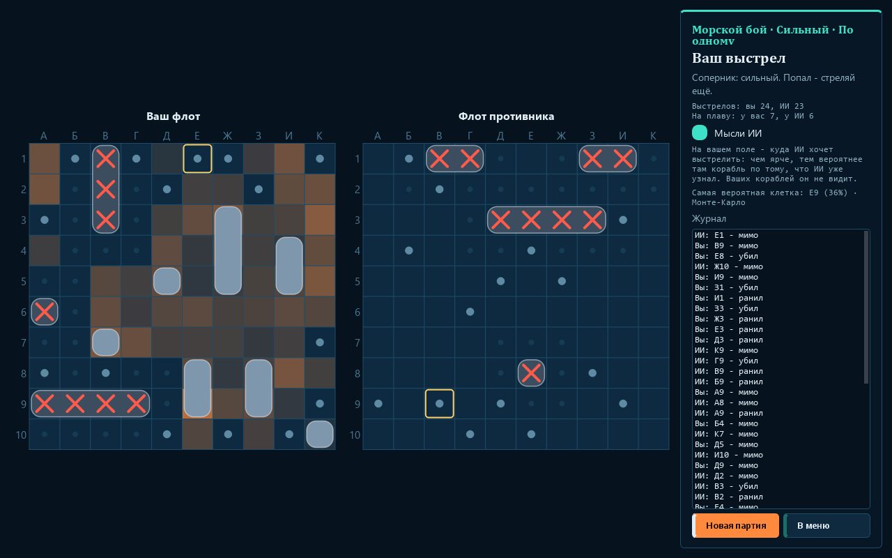
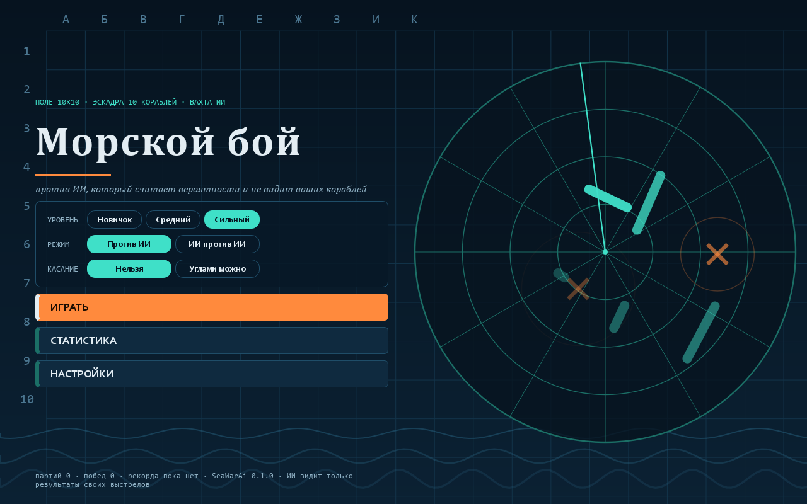
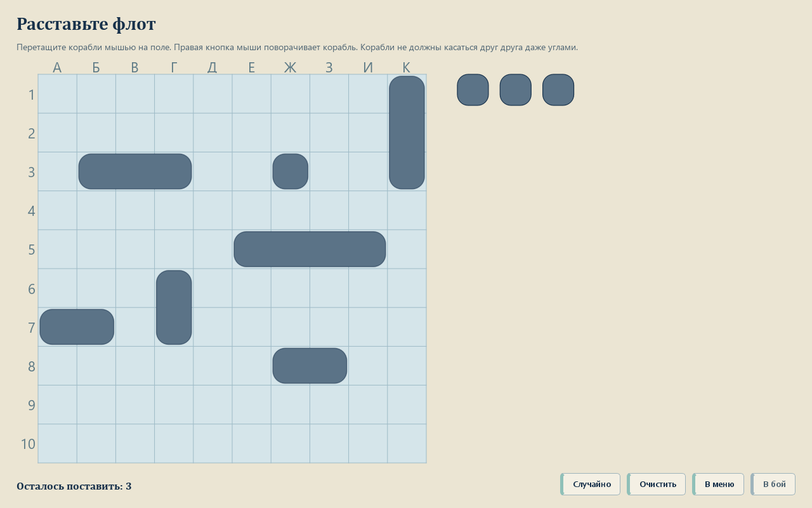
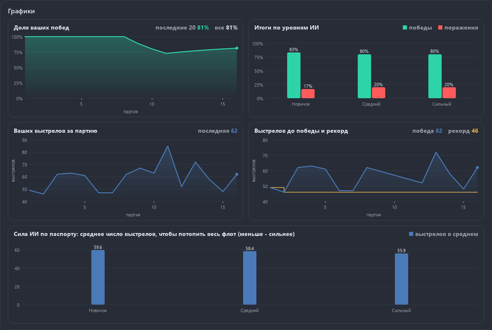

<div align="center">

# Sea Battle vs AI

**Classic Russian sea battle (Battleship) against an AI that computes where your ships are most likely to be. The AI never sees your board: it only gets the results of its own shots, and a law test checks it.**

[Русская версия](README.ru.md)

[](LICENSE)



</div>

## Features

- **Russian rules**: 10 × 10 board, columns А-К (A-J in English), one 4-deck, two 3-deck, three 2-deck and four 1-deck ships. Ships never touch, not even by corners. A hit gives another shot, and the cells around a sunk ship are marked automatically.
- Classic shooting by default. Options: **corners allowed** in the menu (ships may touch by corners, not by sides) and **salvo** in the settings, off by default (as many shots per turn as you have ships afloat; every result is shown at once, hits give no extra shots).
- **Place your fleet with the mouse**: drag a ship from the dock onto the board, right click rotates it; or press **Random**.
- Three AI levels: **novice**, **medium**, **strong**, plus an **AI vs AI** demo with both fleets open.
- **AI thoughts**: a heat map on your board showing where the AI wants to shoot next.
- The AI **learns your habits**: where you usually put your ships and where you shoot first. You can make it forget them in the settings.
- **A "navigator's bridge" start menu of its own**: a night sea with a chart grid, a sonar on the right - the beam turns, ship contacts flash as it passes, rings spread from hits, waves roll along the bottom. Plate buttons with a stripe on the left, capsule toggles, a nautical Cambria title. The light theme is a paper sea chart. Fleet placement, the boards and the battle side panel share its colours. The menu grows with the window up to 4K.
- **Settings span the whole window**, like the statistics.
- Animated splashes and blasts, synthesized sounds, Paint themes (dark and light), Russian and English, the window reopens where it was closed.





- **Statistics with charts** (the shared `aikit.charts`): your share of wins (last 20 and all games), wins and losses against each AI level, your shots per game, shots to win with your record, and the AI strength from the passport as bars. With no games yet a chart says in words what will appear.



## How the AI plays

- **Novice**: a random unknown cell; after a hit it finishes the ship along the line.
- **Medium**: hunt and target. It hunts on a checkerboard (every second cell) while ships of two decks or more are afloat, and skips the cells diagonal to a hit.
- **Strong**: a probability map. It considers every placement of the remaining ships that agrees with what it has seen: no ship on a miss, nothing next to a sunk ship, every hit covered by a ship that is still afloat, and two hits side by side always belong to one ship. The cell with the highest share of placements gets the shot. A wounded ship is finished in the most likely cell where it can continue.
  - When few placements are left, they are **counted exactly**. A test compares this count with a brute-force enumeration of all fleets on a 5 × 5 board.
  - Otherwise a **weighted Monte Carlo** in numpy draws 400 placements at once. Hits are covered first, then the remaining ships are placed, and weights correct for the order. A test checks it against the exact count. Over 18,000 predicted cells the map is calibrated: cells predicted at 0.198 held a ship 19.9% of the time, cells at 0.284 held one 27.7% of the time.
  - Your **habits** become prior weights of the placements. One game changes them little; after about 15 games they weigh half. They are recorded only when a game ends, so the AI never learns the current game's fleet that way.
- **AI fleet placement**: what decides the number of shots is how many cells get marked automatically around sunk ships, and a ship by the edge or in a corner opens fewer of them than a ship in open water. The strong AI draws 40 random fleets (every legal placement equally likely) and picks one of the three with the smallest halo, avoiding the cells where you like to shoot first. There is no fixed pattern to guess. The first version did the opposite: it kept away from the cells a probability shooter tries first, so the ships moved to the middle, and the fleet lasted *shorter* than a random one (54.6 shots against 55.9).

## Honesty, tested

`tests/test_honesty.py` plays a game halfway, then builds a **different** fleet that would have given exactly the same answers to the same shots: sunk ships stay where they are, and the rest are moved anywhere the rules allow. The AI's observation must be identical, and every level must choose the same next shot with the same seed. The window test checks that the AI thread only ever receives that observation, never the fleet.

## Strength

| Level | Mean shots | Median | 10-90% | Min-max |
|---|---:|---:|---:|---:|
| Novice | 59.6 | 60 | 51-68 | 35-84 |
| Medium | 58.4 | 59 | 49-67 | 33-80 |
| Strong | 55.9 | 57 | 48-63 | 28-74 |

10,000 games per level against a random fleet (every legal placement equally likely). The seed is fixed, and the tests recompute part of the games (`python -m game.train.passport`).

- Strong against medium, full games, taking turns to start: **63.2% wins** out of 1 000.
- The strong AI's own placement lasts longer than a random fleet: the medium shooter needs **60.9** shots instead of 58.4, the strong one **56.3** instead of 55.9 (1 000 games each; against the strong shooter the gain is small, about two standard errors).
- A player who likes the middle of the board: after learning 30 of their games the strong AI needs **53.8** shots instead of 55.2 (300 games, gain 1.4 ± 0.5). A player who likes the edges is barely different from a random fleet, since random fleets already lean to the edges; there the gain stayed within noise.

**Why not 45 shots?** Under Russian rules about 41 of the 100 cells get marked automatically around sunk ships, and at the end of a game only about 4 cells are still unknown. So any shooter needs roughly 100 − 41 − 4 ≈ 55 shots, and the AI's skill decides the last few. The probability map is not the bottleneck: it is calibrated, and choosing the shot by information gain did not help.

## Download

Windows builds (installer and portable archive) are in [Releases](../../releases). The builds are not code-signed, so SmartScreen may warn on first start.

## Run

```
pip install -r requirements.txt
python main.py
```

Python 3.13, PySide6 and numpy. Checks: `pip install -r requirements-dev.txt`, then `python -m pytest`. Mutation check: `python tools/mutate.py` breaks every rule and every AI piece on purpose, one at a time, and the tests must notice. 273 checks and 52 mutants, all caught; the menu laws (`tests/test_menu.py`) check that the menu, fleet placement and the side panel are whole from the smallest window to 4K in both themes and languages, the sonar never covers the buttons, and settings take the full width.

## License

MIT, see [LICENSE](LICENSE).
